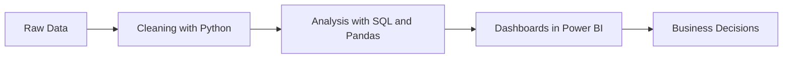

<div align="center">

# Hi there, I'm Aziz Hamdaoui 👋

### 📊 Data Analyst &nbsp;|&nbsp; ☁️ Learning Cloud Computing

*Turning raw data into clear decisions with SQL, Python and BI dashboards.*

<br>

[](https://www.linkedin.com/in/aziz-hamdaoui-088254348)
[](mailto:azizhamdaoui917@gmail.com)


</div>

---

## 🚀 About Me

- 📊 Data Analyst working with **SQL, Python and Power BI** to clean, analyze and visualize data
- ☁️ Currently building skills in **Cloud Computing** (Linux, networking, virtualization, containers)
- 🎯 Looking for opportunities in **data analysis** and **cloud-based data projects**
- 🌍 Based in Morocco · Languages: Arabic, French, English

```python
class AzizHamdaoui:
    def __init__(self):
        self.name = "Aziz Hamdaoui"
        self.role = "Data Analyst"
        self.location = "Morocco"
        self.languages = ["Python", "SQL"]
        self.bi_tools = ["Power BI", "Excel"]
        self.learning = ["Linux", "Docker", "Cloud Computing"]
        self.contact = "azizhamdaoui917@gmail.com"
```

---

## 🛠️ Tech Stack

### 📈 Data Analysis


### 🗄️ Databases & BI


### ☁️ Cloud & Tools (learning)


---

## 🏆 Education & Certifications

| Year | Title | Institution |
|------|-------|-------------|
| _YYYY – YYYY_ | _Your degree / diploma_ | _Your school_ |
| _YYYY_ | _Certification (e.g. Google Data Analytics, Microsoft PL-300)_ | _Provider_ |

---

## 💼 Experience

### 🔹 _Job title_ | _Company_
*Month YYYY — Month YYYY*

- 📊 _What you analyzed and what result you achieved (use numbers if possible)_
- 🗄️ _Databases / queries / dashboards you built_
- 📈 _Impact of your work on the team or the business_

---

## 📁 Featured Projects

| Project | What it does | Tools |
|---|---|---|
| 🔹 **[Project 1 name](https://github.com/azizhm-ui)** | One line: the problem, the data, the result | Python, Pandas |
| 🔹 **[Project 2 name](https://github.com/azizhm-ui)** | One line: the problem, the data, the result | SQL, Power BI |
| 🔹 **[Cloud lab](https://github.com/azizhm-ui)** | Web app deployed on a cloud server with a load balancer | VM, Linux, Docker |

---

## 🔄 My Data Workflow



---

## 🎯 Expertise

| 📊 Data Analysis | 🗄️ Databases | 📈 Visualization | ☁️ Cloud (learning) |
|---|---|---|---|
| Data cleaning | SQL queries & joins | Power BI dashboards | Linux administration |
| Exploratory analysis | Database design | Charts with Matplotlib | Networking basics |
| Statistics | MySQL / PostgreSQL | Storytelling with data | Docker & containers |

---

## 📊 GitHub Stats

<div align="center">


</div>

---

<div align="center">

### 📫 Let's connect

[](https://www.linkedin.com/in/aziz-hamdaoui-088254348)
[](mailto:azizhamdaoui917@gmail.com)

*⭐ Thanks for visiting my profile!*

</div>
